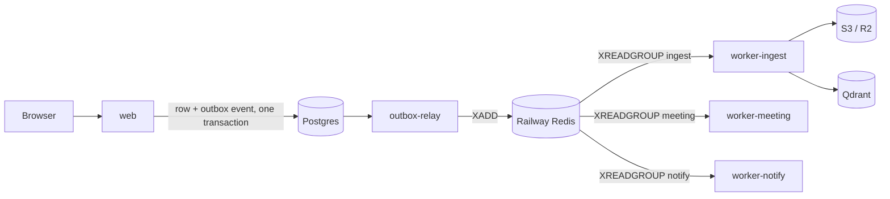

# Railway production deployment

The archive runs on Railway as five services built from one Dockerfile, plus
external Postgres (Neon or Railway Postgres), Qdrant Cloud, and S3 or R2.
Service layout and environment variables live in
[`.railway/railway.ts`](../.railway/railway.ts) (Railway Infrastructure as
Code). The old `railway.toml` config-as-code file is retired; Railway stops
honouring it on 2026-12-01.

| Service | Start command | SERVICE_ROLE | Scales by |
|---|---|---|---|
| `web` | uvicorn (pre-deploy: `python -m bcp_project.migrate`) | web | HTTP load, 2 replicas in production |
| `outbox-relay` | `python -m bcp_project.jobs.relay` | worker | 1 replica (safe to run 2; rows are claimed with `SKIP LOCKED`) |
| `worker-ingest` | `python -m bcp_project.jobs.worker` with `JOB_WORKER_QUEUES=ingest` | worker | Ingest stream lag |
| `worker-meeting` | same, `JOB_WORKER_QUEUES=meeting` | worker | Meeting stream lag; CPU Whisper is slow |
| `worker-notify` | same, `JOB_WORKER_QUEUES=notify` | worker | Rarely needs more than 1 |

## First deploy

1. Install the Railway CLI (5.63 or newer) and link the project: `railway link`.
2. Set shared variables once (Project → Shared Variables): `DATABASE_URL`,
   `JWT_SECRET_KEY` (32+ characters), `QDRANT_URL`, `QDRANT_API_KEY`,
   `AWS_REGION`, `AWS_ACCESS_KEY_ID`, `AWS_SECRET_ACCESS_KEY`,
   `AWS_BUCKET_NAME`, `AWS_S3_ENDPOINT_URL` (empty for AWS), `METRICS_TOKEN`,
   `RESEND_API_KEY`, and the AI provider keys from
   [AI_PROVIDERS.md](AI_PROVIDERS.md).
3. `cd .railway && npm i -D railway@^3.12`, then from the repository root:
   `railway config plan` and `railway config apply`.
4. Create a `staging` environment with the same file. `ctx.environment` keeps
   it to one replica and no custom domain.

Migrations run once per deploy in the web service's pre-deploy step. They are
additive and idempotent, and a Postgres advisory lock serialises concurrent
runs. Workers and the relay set `AUTO_MIGRATE=0` and never touch the schema.

## Images

`SERVICE_ROLE` is a Railway service variable and a Docker build argument.
`worker` images add `ffmpeg` and `faster-whisper`. Both images include
Tesseract with `eng` and `ben` language data. CI builds both roles and fails if
Bangla OCR data or Whisper is missing.

## Observability

- Logs are JSON lines with `service` and `correlation_id`; the same ID follows
  a request from `web` into the outbox event and the worker that processes it.
- `GET /metrics` (Prometheus text) requires `Authorization: Bearer $METRICS_TOKEN`
  in production. It exposes HTTP latency histograms by route template, job
  counters, and stream lag gauges.
- Tracing: set `OTEL_EXPORTER_OTLP_ENDPOINT` and install
  `opentelemetry-sdk opentelemetry-exporter-otlp-proto-http
  opentelemetry-instrumentation-fastapi`, or enable Railway tracing on the
  service.

## Health

- `/healthz`: process liveness (container health check).
- `/readyz`: database reachable and storage probed. The Railway deploy health
  check uses `/readyz` so a deploy that cannot reach Postgres never goes live.
