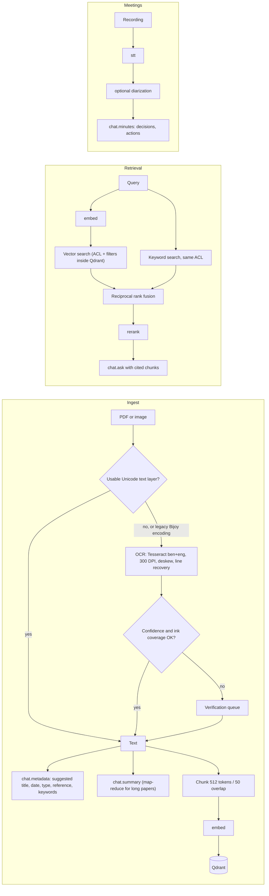

# AI/ML architecture and Bangla language capability

Section 9 items covered here: AI/ML Architecture, Bangla Language Capability. Measured accuracy
is in [`benchmark-report.md`](benchmark-report.md); switching to bank hardware is in
[`local-ai-cutover.md`](local-ai-cutover.md).

## 1. Design principles

1. **One port, many providers.** Every model call goes through `bcp_project.ai` (`chat`, `embed`,
   `rerank`, `transcribe`). Providers: `openai`, `openrouter`, `local` (any OpenAI-compatible
   server: vLLM, TEI, Ollama, faster-whisper), `local_whisper` (in-process), `stub` (tests).
2. **Per-task routing, switchable at runtime.** Tasks `chat.summary`, `chat.minutes`, `chat.ask`,
   `chat.board_brief`, `chat.metadata`, `rerank`, `stt` and the embedding space are routed
   independently. An admin changes a route at `/admin/ai`; the change is audited, takes effect
   within `AI_REGISTRY_REFRESH_SECONDS` (30 s) on every replica, and can be rolled back from the
   route history. With `AI_ROUTE_FOUR_EYES=1` (recommended in production) a switch, reset or
   rollback is only a request until a second admin approves it; the requester cannot approve their
   own change, and request, approval and rejection are each audited (`ai_route_change_*`).
3. **Data classification decides where text may go.** `AI_EGRESS` and the document's sensitivity
   decide whether a cloud provider may see it (see `security.md` section 4). `restricted` text never
   leaves the bank.
4. **Grounded output only.** Summaries, briefings and answers cite document and page. Ask Sonali
   follows "No Source, No Answer": it answers only from retrieved, access-checked excerpts and
   refuses when the archive has no supporting source.
5. **Humans approve what becomes record.** OCR below threshold, suggested metadata, draft minutes
   and briefings all wait for a named person; four-eyes is available for each.

## 2. Pipeline

## 3. Models

| Task | Cloud default (Railway today) | Bank GPU target | Why the bank model |
|---|---|---|---|
| Chat (summary, minutes, Ask, briefing, metadata) | `gpt-4.1-mini` via OpenAI or OpenRouter | Qwen2.5-14B-Instruct on vLLM (32B on two GPUs if benchmarks require) | Strong multilingual instruction following including Bangla, JSON mode, Apache-2.0, 32k context |
| Embeddings | `text-embedding-3-small` (1536-d) | BAAI `bge-m3` on TEI (1024-d) | Multilingual including Bangla, cross-lingual retrieval (Bangla query finds English text and back), MIT |
| Reranking | none or `bge-reranker-v2-m3` | `bge-reranker-v2-m3` on TEI | Multilingual cross-encoder, Apache-2.0 |
| Speech to text | `whisper-1` | `faster-whisper-large-v3` (speaches server) | Bangla supported; runs offline; MIT |
| OCR | Tesseract 5 `ben+eng` (on CPU in the ingest worker, both deployments) | same | Apache-2.0, offline, word confidences for review routing |

Model weights are downloaded once, checked, and mounted read-only (`/models`, `HF_HUB_OFFLINE=1`).
Licences: [`licenses.md`](licenses.md).

**Fine-tuning position.** No model is fine-tuned. Every model is used as published, with its
licence listed in `licenses.md` and its weights checked when downloaded. The system adapts to the bank in three ways that need
no new weights: retrieval from the bank's own archive (answers come only from cited excerpts),
task prompts, and the glossary and confirmed metadata that reviewers build up. This keeps bank data
out of model weights, so nothing has to be "unlearned" when a record is disposed of, and avoids a
model-risk validation per fine-tuned variant. If benchmarks on bank samples later show a gap that
retrieval and prompts cannot close (most likely Bangla speech recognition or handwriting), a
fine-tune would be treated as a new model: trained on in-bank hardware with data the records owner
approves, scored on the same evaluation sets as the model it replaces and required to beat it,
with its training-data reference in the route change notes, and switched in through the four-eyes route change
above, with the old route kept for rollback.

**Embedding space changes are a reindex, not a flag.** Collections are named by model and
dimension (`document_chunks__bge-m3__1024`) behind an alias. `scripts/reindex_embeddings.py`
builds the new collection beside the old one, catches up on documents ingested meanwhile, then
moves the alias. Rollback moves the alias back.

## 4. Bangla capability

| Capability | How it is handled | Evidence |
|---|---|---|
| Bangla, English and mixed documents | Tesseract `ben+eng` per page; language detected per page for metrics and review | `ocr.py`, benchmark OCR tables |
| Conjuncts, vowel signs, hasanta | Grapheme-aware CER; WER tokeniser keeps vowel signs and virama inside words | `evaluation/metrics.py` |
| Lines skipped by Tesseract layout analysis (headstroke merges a line into one blob) | Uncovered ink bands are re-read line by line; pages whose ink is still uncovered are capped in confidence and go to review | Bangla CER 3.2% → 1.8% on the synthetic set |
| Overconfident Bangla OCR | Separate page threshold `OCR_BANGLA_PAGE_REVIEW_THRESHOLD` (recommend 92 for the POC) | Confidence 85–92 pages showed the same error rate |
| Legacy Bijoy / SutonnyMJ PDFs (ANSI-encoded Bangla text layer) | Detected (`legacy_bangla_text`) and OCR'd from the rendered page instead of indexing the garbled text layer | `tests/test_phase10_evidence.py`; must be measured on bank samples |
| Bangla and English digits | Folded for matching and metrics (`০১২৩` = `0123`) | `evaluation/metrics.py` |
| Cross-lingual search | Multilingual embeddings; bilingual retrieval set with 50 Bangla and 50 English queries in CI | `eval/retrieval_bilingual.jsonl` |
| Bangla answers and minutes | Prompts require answering in the question's language and keeping the transcript's language | `services/ask_sonali.py`, `services/minutes.py` |
| Bangla keyword search | Unicode case folding; Bangla-aware tokeniser (`\w` alone splits words at vowel signs) | `qdrant_store.py`, `ai/providers.py` |
| Bangla in generated PDFs (minutes) | Noto Sans Bengali shaped with HarfBuzz (raqm) | `minutes_pdf.py` |

**Known limits.** Handwriting is not supported by Tesseract and is routed to review. Bangla speech
recognition on board-room audio (several speakers, code-switching) has not yet been measured on
real recordings; this is the largest open accuracy question and is in the POC scope.

## 5. Guardrails

- Metadata, minutes, briefings and answers are requested as JSON. If the model fails or returns
  unusable output, nothing is published: the item stays a draft (or the metadata form stays empty)
  for a person to complete.
- Ask Sonali drops any citation to a document that was not in the supplied excerpts, and turns an
  answer without a Document + Page citation into a refusal.
- Evidence comes only from documents the user may find (section 3 of `security.md`); evidence whose
  sensitivity forbids the routed provider is withheld before the prompt is built.
- Long documents use map-reduce with page-tagged chunks, so citations survive summarisation.
- Provider and model are stored with each answer, metadata suggestion and briefing, and every Ask
  question is audited with the number of sources and citations.
