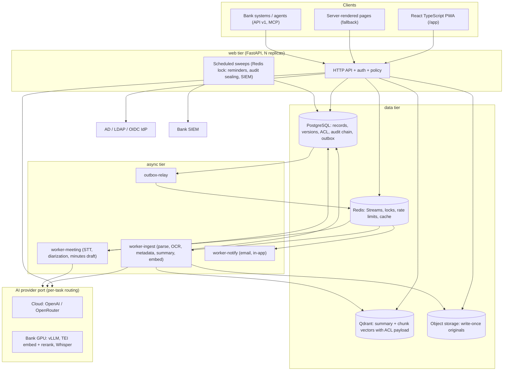
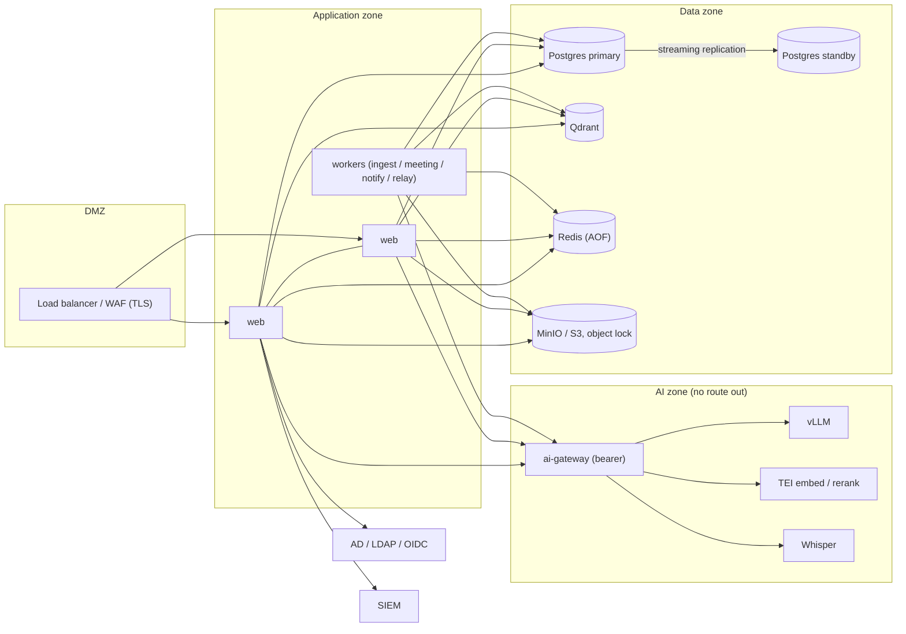
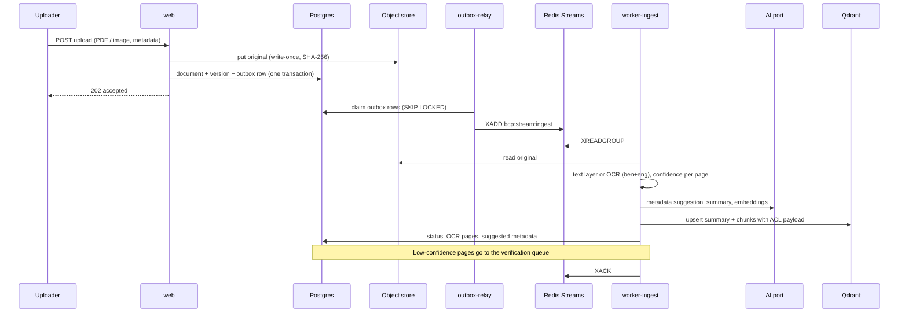
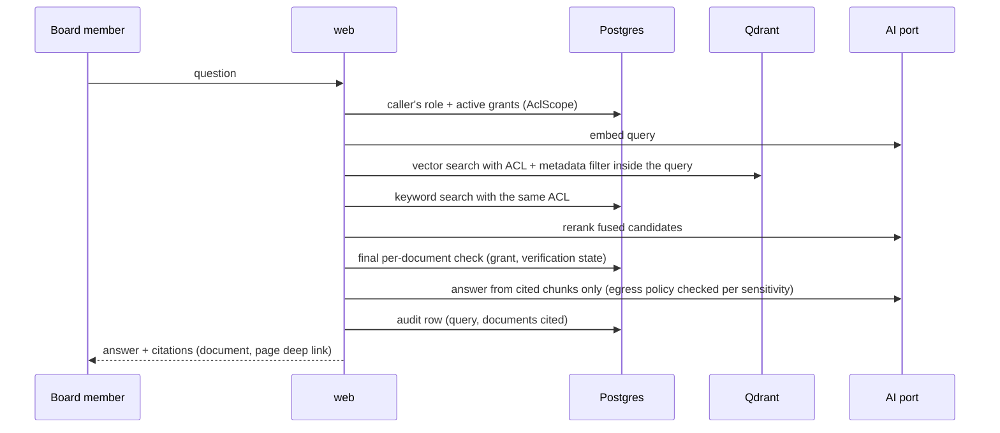

# Solution, deployment, and data-flow architecture

Section 9 items covered here: Detailed Solution Architecture, Deployment Architecture, Integration
Architecture, Data Flow Diagram. This file describes the system as built (October 2026). Where an
older document disagrees (`docs/ARCHITECTURE.md` still describes a Redis list queue), this file wins.

## 1. Components

| Component | Code | Responsibility |
|---|---|---|
| Web API | `src/bcp_project/main_api.py`, `routers/` | Sign-in, search, Ask Sonali, document view, meetings, board papers, admin. Stateless; scales horizontally. |
| Policy | `policy.py`, `access_control.py`, `search_acl.py` | Role scopes, document grants, sensitivity, vector ACL filter. |
| Outbox + relay | `jobs/outbox.py`, `jobs/relay.py` | A job row is written in the same transaction as the business row, then published to a stream. No job is lost if Redis is down at upload time. |
| Workers | `jobs/worker.py`, `jobs/handlers.py` | Consumer groups per stream (`bcp:stream:ingest`, `meeting`, `notify`), retries with backoff, dead-letter stream `bcp:stream:dead`, admin requeue at `/admin/queues`. |
| Ingest pipeline | `services/ingest.py`, `ocr.py`, `pdf_parser.py`, `chunker.py`, `services/metadata_suggest.py` | Text layer or OCR (Bangla + English, line recovery, confidence), metadata suggestion, summary, chunking, embeddings. |
| Search and Ask | `services/search.py`, `services/ask_sonali.py` | Hybrid vector + keyword retrieval, ACL filter inside the vector query, reranker, cited answers. |
| Meetings | `routers/meeting_minutes.py`, `services/minutes.py`, `asr.py`, `diarization.py` | Recording upload, transcription, draft minutes, decisions and actions, review and approval. |
| Board papers | `routers/briefings.py`, `services/briefing.py`, `services/decision_register.py` | Eight-heading cited briefing, map-reduce over long papers, decision register. |
| AI port | `ai/providers.py`, `ai/routing.py`, `ai/egress.py` | Chat, embeddings, rerank, STT behind one interface; provider and model chosen per task at runtime. |
| Audit | `access_control.write_audit`, `services/audit_chain.py`, `services/siem.py` | Append-only, hash-chained audit log; SIEM forwarding. |
| DR tooling | `src/bcp_project/dr/`, `scripts/dr_*.py` | Encrypted backups, restore drill, failover drill. |

## 2. Deployment

Two deployment targets share one image (`Dockerfile`, `SERVICE_ROLE` selects the process).

**Railway (current production path).** Five services from `.railway/railway.ts`: `web` (2 replicas,
runs migrations pre-deploy), `outbox-relay`, `worker-ingest`, `worker-meeting`, `worker-notify`.
Managed data plane: Neon Postgres, Qdrant Cloud, Redis (Railway or Upstash, persistence on),
S3 or R2. `scripts/autoscale_workers.py` sets worker replica counts from stream backlog.
Runbook: [`docs/RAILWAY.md`](../RAILWAY.md).

**Bank data centre (target).** The same services on the bank's container platform, with:

The AI zone compose file is [`deploy/onprem/docker-compose.gpu.yml`](../../deploy/onprem/docker-compose.gpu.yml):
model containers sit on an internal network with no egress; only the gateway joins the archive network.
DR site layout and drills: [`docs/DR.md`](../DR.md).

## 3. Data flows

### Document upload to searchable

### Search and Ask Sonali

### Meeting recording to approved minutes

Recording upload → `bcp:stream:meeting` → STT (provider by routing) → optional diarization → draft
minutes with decisions and actions → secretary edits (`minutes_save`) → approval (`minutes_approve`)
→ only approved minutes are indexed for search. Every step is audited.

### Audit evidence

Every request that reads or changes a record calls `write_audit`. A scheduled sweep seals rows into a
SHA-256 chain and forwards sealed rows to the SIEM; the cursor advances only after the SIEM accepts.

## 4. Integration architecture

| Integration | Direction | Mechanism | Reference |
|---|---|---|---|
| AD / LDAP / OIDC | inbound identity | LDAP bind or OIDC code flow with PKCE; group-to-role map | `docs/SECURITY_OPERATIONS.md` |
| SIEM | outbound events | CEF or JSON over syslog (UDP/TCP/TLS) or HTTP NDJSON | `services/siem.py` |
| Bank systems and agents | inbound | `/api/v1` with scoped service keys, MCP stdio server | `docs/API.md`, `docs/INTEGRATION.md` |
| Document sources (DMS, shared drives) | inbound pull | Connector port (`ports/document_source.py`), cursor per source | `services/connector_sync.py` |
| Core banking, loans, HR lookups | inbound read (minimal fields) | Facades behind `cbs:customer.read_min`, `loan:read_min`, `hr:read_min` scopes | `services/customer_query.py` |
| Email | outbound | Resend API (replaceable with bank SMTP relay) | `notify.py` |
| AI models | outbound | OpenAI-compatible HTTP; cloud or bank GPU per task | `docs/AI_PROVIDERS.md` |
| Object storage | outbound | S3 API (AWS, R2, MinIO) | `aws_utils.py` |

## 5. API documentation

- Human-readable reference: [`docs/API.md`](../API.md).
- Machine-readable: `PYTHONPATH=src python scripts/export_openapi.py` writes `frontend/openapi.json`
  (the React client is generated from it, so the schema is always current). Interactive docs are
  served at `/docs` in Dev and UAT and switched off in production.
