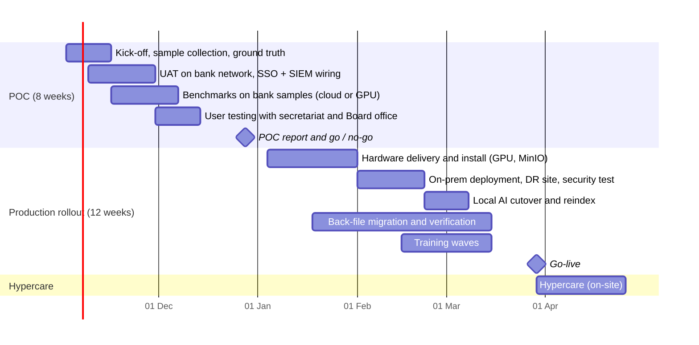

# Implementation methodology, timeline, training and support

Section 9 items covered here: Implementation Methodology, Project Timeline, Training & Knowledge
Transfer Plan, Support & Maintenance Model.

## 1. Methodology

Phased delivery with a working, deployed system at the end of every phase. Phases 0–9 of the build
plan are complete on the Railway environment; the remaining work is the bank POC and the move onto
bank infrastructure.

| Practice | How it is applied |
|---|---|
| Two-week iterations | Demo to the bank's product owner at the end of each; backlog re-prioritised with the bank |
| Definition of done | Code reviewed, automated tests pass in CI (unit, migrations, retrieval evaluation with zero leaks, dependency and ZAP scans), docs updated, deployed to UAT |
| Environments | Dev → UAT → Production, promoted by image digest; migrations run once per deploy |
| Change control | Bank CAB for production; every AI route change and admin action is audited in-product |
| Quality gates for AI | Benchmarks (`benchmark-report.md`) rerun before any model or prompt change reaches production |
| Security | Threat model per module, CI security gates, pre-go-live penetration test by the bank or a third party |
| Data | Bank documents stay in bank-controlled storage; synthetic data for development |

## 2. Timeline (from POC start)

Dates assume POC start on 2 November 2026 and hardware lead time of four weeks; both are the bank's
decisions. The critical path is GPU hardware delivery; the cloud deployment keeps the POC unblocked
while it arrives.

## 3. Training and knowledge transfer

| Audience | Format | Content | Duration |
|---|---|---|---|
| Board members | 1:1 or small group, tablet in hand | Board pack, briefings, search, Ask Sonali, requesting access | 45 min |
| Board secretariat | Hands-on lab with UAT data | Meetings, recordings, minutes workflow and four-eyes, briefings, access approvals | 2 × half day |
| Records staff (uploaders, reviewers) | Hands-on lab | Upload, verification queue, metadata confirmation, Bangla OCR pitfalls (Bijoy fonts, poor scans) | 1 day |
| Administrators | Workshop | Users and directory mapping, AI routing, queues, audit verification, security status | 1 day |
| IT operations | Workshop + shadowing | Deployment, scaling, monitoring, backups, restore and failover drills, secret rotation, local AI stack | 3 days + 2 weeks shadowing |
| Developers (bank IT) | Code walkthrough + paired changes | Architecture, policy and ACL design, AI port, adding a document type or connector, CI | 5 days |

Materials: this evidence pack, the runbooks (`docs/RAILWAY.md`, `docs/DR.md`,
`docs/SECURITY_OPERATIONS.md`, `local-ai-cutover.md`), recorded sessions in Bangla and English, and
one-page quick guides per role. Knowledge transfer is complete when bank IT has run a restore drill,
a failover drill and one production release without vendor help.

## 4. Support and maintenance

| Severity | Example | Response | Workaround / fix target |
|---|---|---|---|
| 1 — critical | Archive unavailable, data integrity or security incident | 30 minutes, 24 × 7 | 4 hours workaround |
| 2 — high | Search or uploads failing for many users; AI tasks down | 2 hours, business hours | 1 business day |
| 3 — medium | Single feature degraded; OCR quality issue on a document class | 1 business day | next release |
| 4 — low | Questions, cosmetic issues, enhancement requests | 2 business days | backlog |

Included in maintenance:

- Monthly security patch release covering dependency updates from Dependabot and `pip-audit`, plus
  base images.
- Quarterly model and prompt review, rerunning the benchmarks.
- Quarterly restore drill and twice-yearly failover drill, recorded in `docs/evidence/drills/`.
- Quarterly access review support: reports of grants and role changes from the audit log.
- Capacity review every six months against `docs/CAPACITY.md`.

Second-line support moves to bank IT after hypercare. The vendor stays third line, handling code
fixes and model issues.
