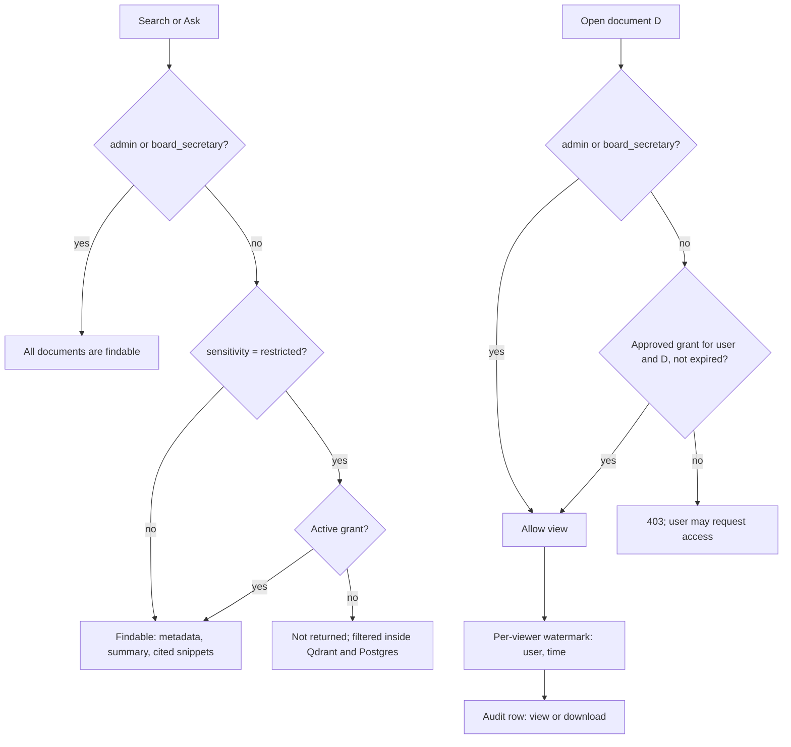

# Cybersecurity architecture and access model

Section 9 items covered here: Cybersecurity Architecture, User Access / Authorization Model.
Operational runbooks (sign-in modes, SIEM, rotation) are in
[`docs/SECURITY_OPERATIONS.md`](../SECURITY_OPERATIONS.md); this file is the design view for review.

## 1. Defence layers

| Layer | Control | Where |
|---|---|---|
| Network | TLS 1.2/1.3 only at the reverse proxy or load balancer; firewall zones and port matrix; data and AI zones not reachable from users; AI containers have no route out (`internal: true` network) | `deploy/onprem/nginx-archive.conf`, [network.md](network.md), `deploy/onprem/docker-compose.gpu.yml` |
| Platform | Containers run as uid 10001 with a read-only root filesystem, no capabilities and `no-new-privileges`; host CIS checklist | `deploy/onprem/docker-compose.hardening.yml`, [hardening.md](hardening.md) |
| Identity | AD / LDAP bind or OIDC (PKCE, nonce, JWKS-verified ID token); TOTP MFA for privileged roles; directory groups map to roles and are re-synced at each sign-in; break-glass accounts limited and audited | `auth.py`, `services/external_identity.py`, `mfa.py` |
| Session | Signed JWT in an HttpOnly cookie, 8-hour expiry, sliding refresh, secret rotation with a previous-key window; CSRF token on every form post | `auth.py`, `security.py` |
| Application | Role scopes, per-document grants with expiry, sensitivity labels, four-eyes approval for OCR review, minutes, briefings, record disposal and (optionally) AI route changes | `policy.py`, `access_control.py` |
| Search and AI | ACL filter executed inside the Qdrant query (restricted vectors never leave the store for unauthorised users), final Postgres check, AI egress policy per sensitivity | `search_acl.py`, `ai/egress.py` |
| Content | Upload type sniffing (PDF, PNG, JPEG, TIFF), size and pixel caps, ClamAV scan that fails closed, write-once originals with SHA-256 and optional S3 Object Lock | `intake.py` |
| Delivery | Per-viewer watermark on every view and download; download is admin-only; `Cache-Control: no-store` | `pdf_watermark.py`, `pdf_delivery.py` |
| Abuse | Login throttling per user and IP; Redis-backed rate limits per user or service key, with a local fallback when Redis is down. The client IP used for throttling and audit is taken from `X-Forwarded-For` only as far as the trusted proxies go (`TRUSTED_PROXY_HOPS`, default 1), so a client cannot forge its address to dodge a lockout or falsify the audit trail | `security.py` (`client_ip`), `rate_limit.py` |
| Browser | CSP, HSTS, X-Frame-Options, nosniff, Referrer-Policy; SameSite cookies | `security.py` |
| Evidence | Append-only audit table (database triggers), SHA-256 hash chain, SIEM forwarding with an at-least-once cursor, verification endpoint | `services/audit_chain.py`, `services/siem.py` |
| Data at rest | Postgres and object storage encrypted by the platform; TOTP secrets encrypted with `MFA_ENCRYPTION_KEY`; backups AES-256-GCM with a key held apart from the backups | `mfa.py`, `src/bcp_project/dr/crypto.py` |
| Monitoring | Prometheus alerts on failed sign-ins, lockouts, rate-limit spikes and directory outages routed to the SOC; `/metrics` needs a bearer token | [monitoring.md](monitoring.md) |
| Supply chain | `pip-audit`, `bandit`, Dependabot, OWASP ZAP baseline and Trivy image scan in CI; license inventory; model weights pulled once into a read-only volume, images pinned by digest | `.github/workflows/ci.yml`, `docs/evidence/licenses.md` |

## 2. Roles and scopes

Four human roles. Directory groups map onto them (`OIDC_ROLE_MAP`, `LDAP_ROLE_MAP`); the most
privileged mapped group wins.

| Capability | admin | board_secretary | board_member | uploader |
|---|---|---|---|---|
| Upload documents, add versions | ✓ | | | ✓ |
| OCR verification queue (approve or reject pages) | ✓ | ✓ | | ✓ |
| Search, Ask Sonali, archive browse | ✓ | ✓ | ✓ | |
| See `restricted` documents without a grant | ✓ | ✓ | | |
| Request access to a document | ✓ | ✓ | ✓ | |
| Approve or revoke access requests | ✓ | ✓ | | |
| Open (view) an archive document | ✓ | ✓ | with an approved, unexpired grant | |
| Open papers of a meeting they are invited to | ✓ | ✓ | ✓ | ✓ (invitee) |
| Download a document (watermarked) | ✓ | | | |
| Create meetings, upload recordings, edit minutes, decisions, actions | ✓ | ✓ | | |
| Approve minutes and briefings (four-eyes) | ✓ | ✓ | | |
| Read approved briefings and the decision register | ✓ | ✓ | ✓ | |
| Legal hold; propose or approve disposal (four-eyes) | ✓ | ✓ | | |
| Manage users, AI routing, queues, retention schedule; verify the audit chain | ✓ | | | |

Service clients (bank systems, agents) authenticate with API keys and receive explicit scopes from
`policy.Scope` (for example `docs:search`, `ask:sonali`, `cbs:customer.read_min`). Human roles map to
default scope sets in `policy.ROLE_SCOPES`; `uploader` has no read scopes.

## 3. Document-level authorization

Two separate questions are answered for every document: can the user **find** it (search results,
Ask Sonali citations), and can the user **open** it.

The find rule is evaluated twice: once inside the vector query (payload `allowed_roles` plus
granted document IDs) and once in Postgres on the fused results. A leak test runs in CI on every
commit (`eval/retrieval_bilingual.jsonl`, 0 restricted leaks tolerated). Meeting papers follow the
meeting's invitee list instead of grants.

## 4. Sensitivity and AI egress

| Sensitivity | Search visibility | `cloud_allowed` | `restricted_local_only` | `internal_only` |
|---|---|---|---|---|
| public | all archive roles | cloud or local | cloud or local | local only |
| internal (default) | all archive roles | cloud or local | cloud or local | local only |
| confidential | all archive roles | cloud or local | local only | local only |
| restricted | privileged roles and grant holders | local only | local only | local only |

`restricted` never goes to a cloud provider under any setting. When a task's configured provider is
cloud and the content is not allowed to leave, the router falls back to the local model or refuses
the call; it never silently sends it. Bank production should run `AI_EGRESS=internal_only` once
the GPU cluster is live (see `local-ai-cutover.md`).

## 5. Audit coverage

Audited actions include sign-in (success, failure, MFA, SSO, break-glass), search and Ask queries
with cited documents, every view and download, access request and review, uploads and new
versions, OCR verification (`verify_open`, `verify_approve`, `verify_reject`), metadata confirmation, minutes
save/submit/approve/amend, briefing generate/edit/approve, AI routing changes (request, approval,
rejection when four-eyes is on), retention rule changes, legal hold set and release, disposal
proposal, approval, rejection, failure and execution, user and role changes, dead-letter retries,
audit-chain verification. Rows carry user, role, IP, correlation ID,
and object ID, and are sealed into the hash chain within `AUDIT_SEAL_INTERVAL_SECONDS` (30 s).

## 6. Residual risks and bank-side controls

| Risk | Mitigation in the product | Bank-side control needed |
|---|---|---|
| A database owner disables audit triggers | SIEM already holds `rowHash`/`prevHash`; a rewritten chain will not match | Separate DBA and application admin duties; SIEM retention |
| Screenshots or photos of watermarked pages | Visible per-user watermark; view audit | Policy and DLP on endpoints |
| Compromised admin account | MFA, directory-driven role, audit, four-eyes on approvals | PAM for admin accounts; periodic access review |
| Cloud AI provider processes `internal`/`confidential` text before cutover | Egress policy; `restricted` stays local | Approve `restricted_local_only` or `internal_only` per data classification policy |
| Backup key loss | Key is never stored with backups; key ID recorded in each backup | Key escrow in HSM or sealed envelope under dual control |
