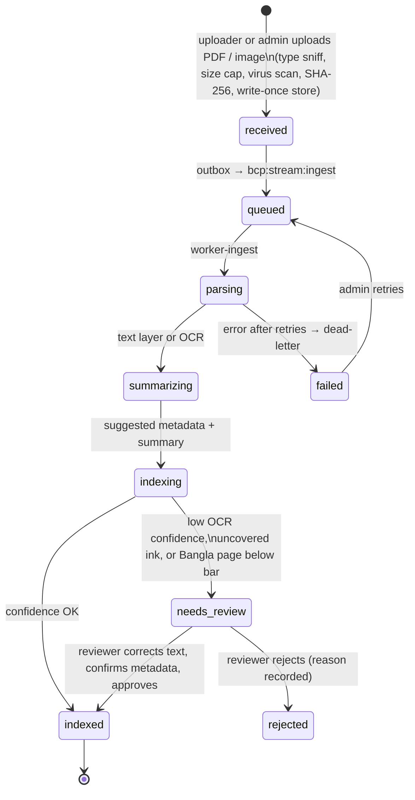

# Business workflows by module

Section 9 item covered here: Business Workflow Diagrams. Each workflow names the role that acts,
the state stored in Postgres, and the audit action written. Roles are defined in `security.md`.

## 1. Document intake, OCR verification and metadata confirmation



| Step | Who | What they see | Audit action |
|---|---|---|---|
| Upload | uploader, admin | Document type, reference, sensitivity, department | `upload` |
| Verify | uploader, board_secretary, admin (four-eyes optional via `OCR_REVIEW_FOUR_EYES`) | Page image beside extracted text, low-confidence words marked | `verify_open`, `verify_approve`, `verify_reject` |
| Confirm metadata | same | AI-suggested title, date, type, reference, keywords, each editable | `metadata_confirm changed=…` |
| New version | uploader, admin | Previous versions stay readable; each has its own SHA-256 | `version_upload` |
| Retry a failed ingest | admin | Error and attempt count | `ingest_retry` |

Only text a person has accepted (or text whose confidence passed the bar) is indexed for search.

## 2. Access to a document

```mermaid
sequenceDiagram
  actor M as Board member
  actor S as Board secretary / admin
  M->>Archive: finds document in search (metadata, summary)
  M->>Archive: requests access (reason, duration)
  Archive->>S: in-app + email notification
  S->>Archive: approve (expiry) or deny
  Archive->>M: notification
  M->>Archive: opens document (watermarked per viewer)
  Note over Archive: grant expires automatically; can be revoked
```

States: `pending → approved | denied`, `approved → revoked`; expired grants stop working without a
state change. Audit: `access_request_create`, `access_request_approved` / `_denied` / `_revoked`,
`view`, `view_file`, `download`.

## 3. Search and Ask Sonali

1. User searches or asks in Bangla or English, optionally filtering by department, category,
   document type, reference number and date range.
2. Results are limited to what the user may find; each shows document, page and snippet with a deep
   link that opens the viewer at the cited page.
3. Ask Sonali answers only with Document + Page citations; otherwise it refuses
   ("No Source, No Answer"). The user opens cited pages subject to section 2.

Audit: `search`, `ask_sonali` (with sources and citations count, provider and model).

## 4. Board meeting lifecycle

```mermaid
stateDiagram-v2
  [*] --> draft: AI draft or manual
  draft --> draft: secretary edits (minutes_save)
  draft --> in_review: submit (locked while in review)
  in_review --> draft: reject with comment
  in_review --> approved: approve — four-eyes: approver ≠ submitter or last editor
  approved --> draft: admin amends (reason recorded)
  approved --> [*]: indexed for search; PDF rendition generated
```




Decisions and actions are stored as rows (owner, due date, status) and feed the decision register.
Audit: `transcription_start`, `transcription_stop`, `recording_upload`, `minutes_regenerate`,
`minutes_save`, `minutes_submit`, `minutes_reject`, `minutes_approve`, `minutes_amend`,
`decision_add` / `_edit` / `_delete`, `action_add` / `_edit` / `_status` / `_delete`.

## 5. Board paper briefing

```mermaid
stateDiagram-v2
  [*] --> ai_draft: generate (map-reduce over the whole paper;\neight Board headings, each point cites a page)
  ai_draft --> ai_draft: management edits a section (briefing_edit)
  ai_draft --> management_reviewed: management marks reviewed
  management_reviewed --> ai_draft: returned with comment
  management_reviewed --> approved: approver ≠ reviewer and last editor (four-eyes)
  approved --> ai_draft: admin reopens (reason recorded)
  approved --> [*]: visible to Board members
```



Board members never see an unapproved briefing. Approved decisions appear in the decision register
(`/board/decisions`) with links back to the paper and the minutes.
Audit: `briefing_generate`, `briefing_edit`, `briefing_review`, `briefing_approve`,
`briefing_return`, `briefing_reopen`.

## 6. Administration

| Task | Where | Audit |
|---|---|---|
| Users and roles (or directory group mapping) | `/admin/users`, `OIDC_ROLE_MAP` / `LDAP_ROLE_MAP` | `user_create`, `user_update`, `user_delete`, `user_provisioned`, `user_role_synced`, `mfa_reset` |
| Switch AI provider or model per task; roll back | `/admin/ai` | `ai_route_switch`, `ai_route_reset`, `ai_route_rollback` |
| Failed jobs: inspect and retry | `/admin/queues` | `job_retry` |
| Verify the audit chain | `POST /api/admin/audit/verify` | `audit_chain_verified` |
| Backups, restore and failover drills | `scripts/dr_*.py` | drill records in `docs/evidence/drills/` |
