# Sonali Bank AI Archive: Visual Documentation Guide

## 1. System architecture

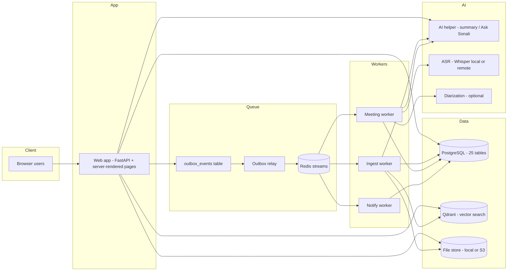

## 2. Document lifecycle

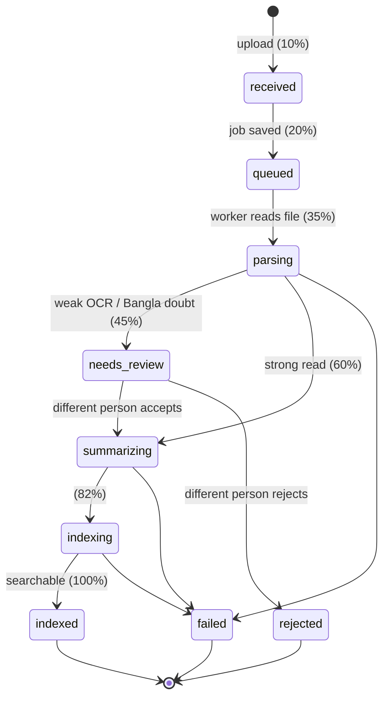

## 3. Upload to search (sequence)

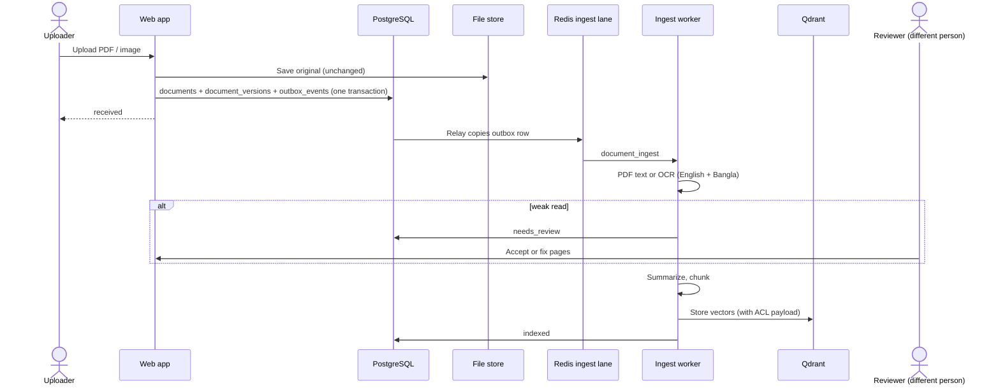

## 4. Meeting speech to approved minutes

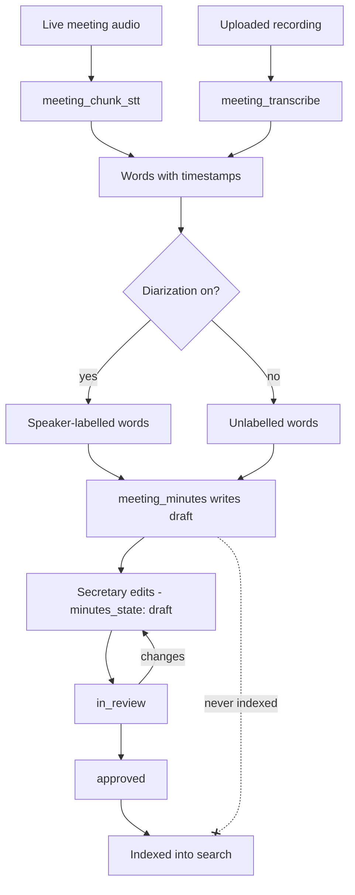

### The three meeting clocks

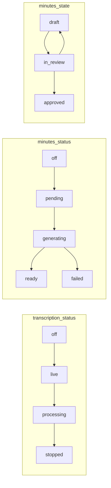

## 5. Queue lanes

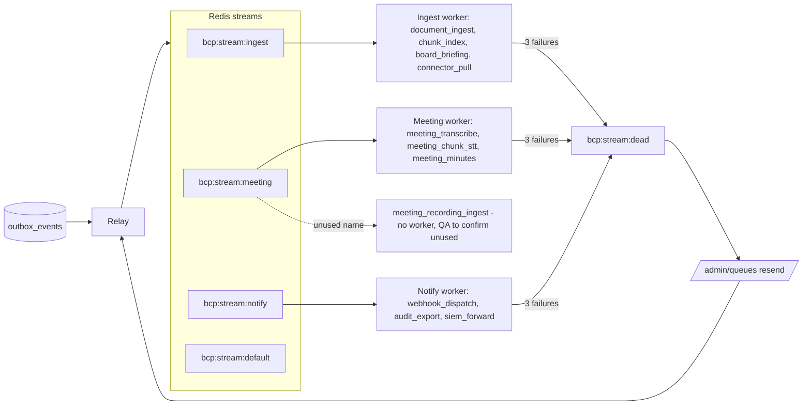

## 6. Roles and permissions

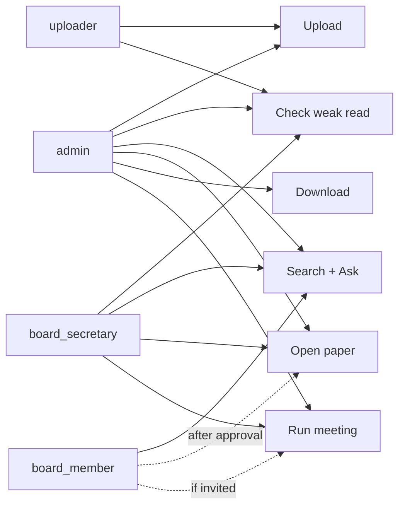

## 7. Access request flow (board member)

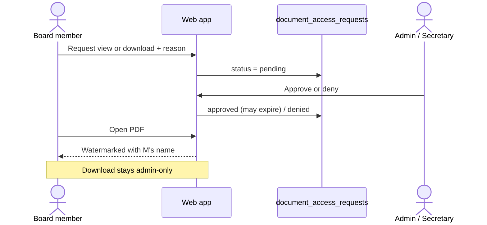

## 8. Folder ownership

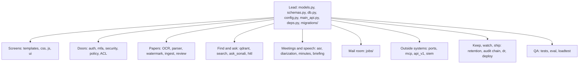

## 9. Database ERD (25 tables)

### 9a. Papers

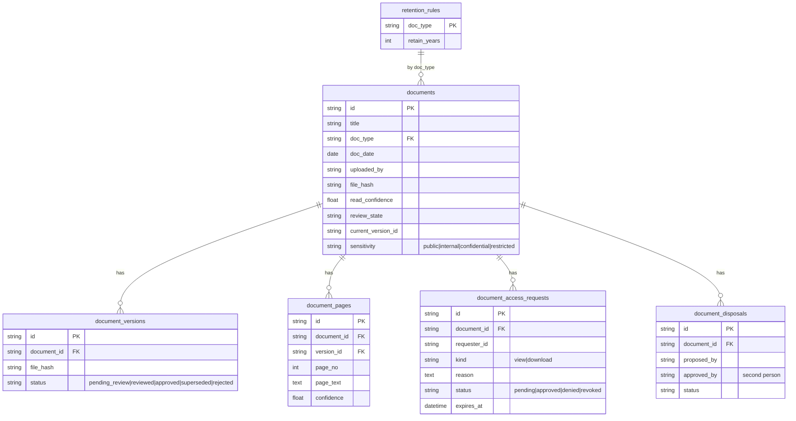

### 9b. Meetings

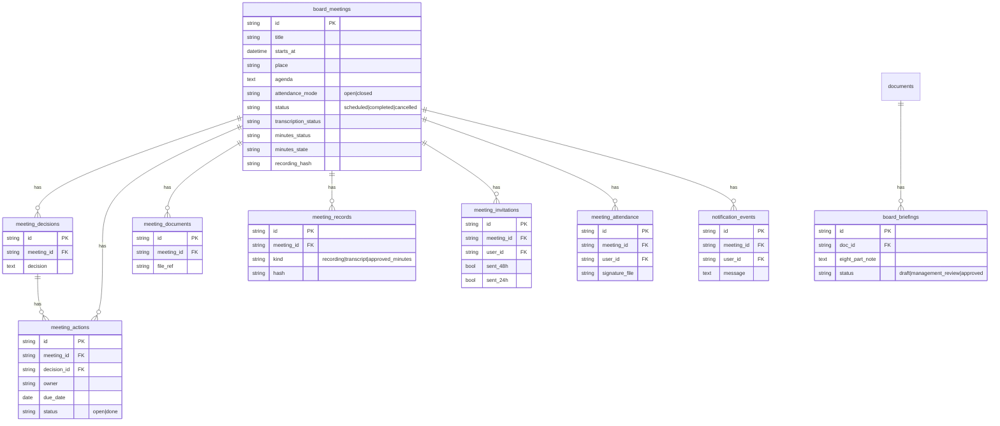

### 9c. People and safety

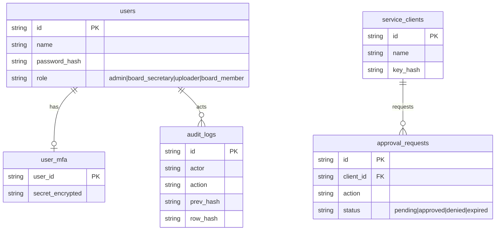

### 9d. Workers and AI

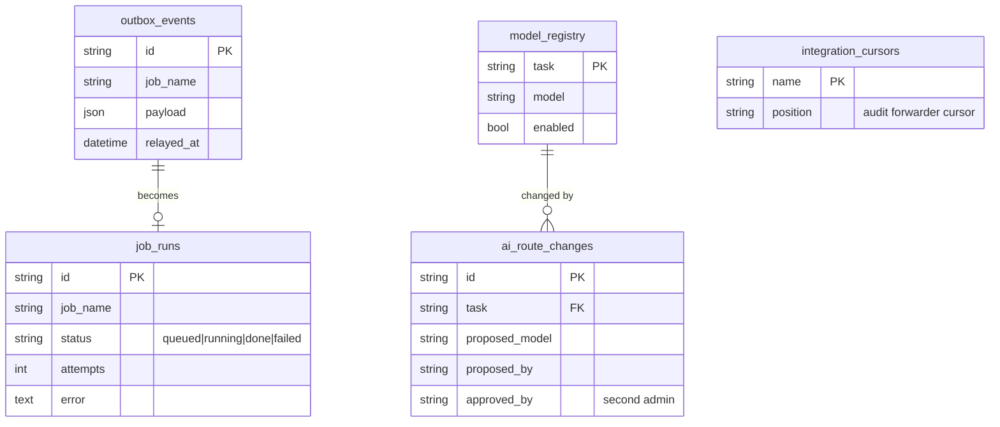

## 10. Where each store sits

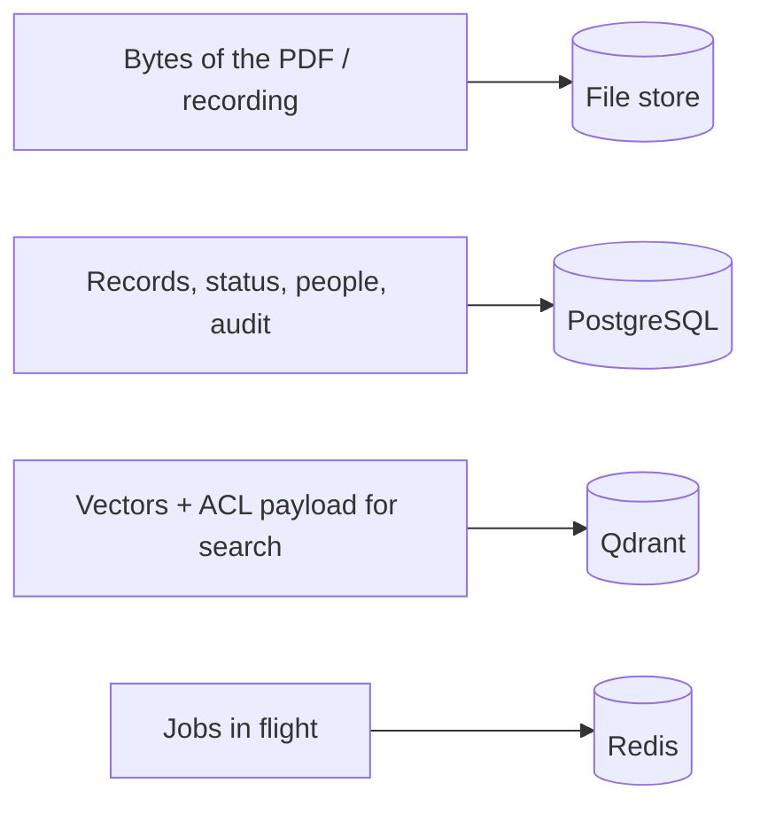
